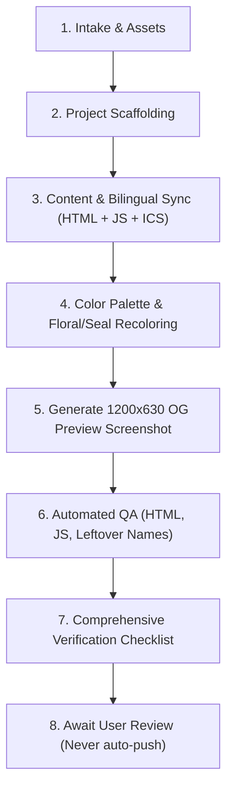

# Quinceañera Invitation Workflow (`quince-workflow`)

This skill automates the complete end-to-end creation, adaptation, styling, and verification of a digital quinceañera invitation in the Diseños Luna repository.

---

## Workflow Overview

---

## Phase 1: Intake & Assets Gathering

1. **Verify Inputs**:
   - **Template**: Base folder to clone (defaults to `dianalucero` or user-specified folder).
   - **Intake Form**: Client submission containing:
     - Order Reference, Client Name & Phone, Email.
     - Celebrant Name, Event Date (Year, Month, Day, Day of Week, Ceremony Time).
     - Color Scheme / Swatch.
     - Ceremony Venue (Name, Address, Time).
     - Reception Venue (Name, Address, Times, Milestones).
     - Court of Honor (Chambelanes / Damas).
     - Dress Code notes (colors to avoid, formality).
     - Gift Registry (Wishing well / Sobre de regalo / links).
     - Music Request (Song & Artist).
     - Special Notes / Custom messages.
   - **Media Assets**:
     - Celebrant photo (`photos/celebrant.png` / `photos/celebrant.jpg`)
     - Venue photos (`photos/venue-church.jpg`, `photos/venue-reception.jpg`)
     - Audio file (`music/song.m4a`)

---

## Phase 2: Project Scaffolding

1. Create target folder (e.g., `mariagomez/` in lowercase alphanumeric).
2. Copy files from the base template folder into the target folder:
   - Exclude any `.bak`, `.tmp`, or OS metadata (`.DS_Store`).
3. Save the raw client intake form to `<target>/README.md`.

---

## Phase 3: Bilingual Content & Data Synchronization

1. **Update `index.html`**:
   - `<title>` and `<meta name="description">`
   - Celebrant name in hero, envelope inside card, and countdown section.
   - Parents announcement line.
   - Date display box (Month, Day, Day of week, Time, Year).
   - Countdown timer target date (`data-target-date="YYYY-MM-DDTHH:MM:SS"`).
   - Ceremony venue: Name, street address, city, state, zip, time, Google Maps URL, photo.
   - Reception venue: Name, street address, city, state, zip, times, Google Maps URL, photo.
   - Court of Honor: Roster member cards, monograms, and names.
   - Event Guidelines: Dress code with bold emphasis on avoided colors, banquet details, photo sharing, wishing well, contact phone tile with clickable `tel:` link.
   - Music Player: Song title and artist.
   - Bump asset cache-busting queries (`style.css?v=...`, `main.js?v=...`, `floral-divider.png?v=...`, `wax-seal.png?v=...`, `og-preview.jpg?v=...`).

2. **Update `main.js`**:
   - Synchronize all dictionary entries under both `en` and `es` in `const translations = { ... }`:
     - `entry-invited`, `entry-subtitle`, `card-quince`, `invite-parents`, `invite-preamble`, `invite-quince`, `invite-daughter`, `invite-celebrant`, `invite-date-*`.
     - `countdown-title`, `venue-section-title`, `badge-ceremony`, `ceremony-time-desc`, `badge-reception`, `reception-time-desc`.
     - `court-title`, `court-chambelanes-title`.
     - `dresscode-title`, `dresscode-subtitle`, `dresscode-desc` (matching bold tags in both languages).
     - `dinner-*`, `contact-*`, `photos-*`, `registry-*`, `message-*`, `rsvp-*`.

3. **Update `event.ics`**:
   - Set `UID:<target>-quinceanera-<YYYYMMDD>@disenosluna.com`.
   - Set `DTSTART` and `DTEND` in UTC or local format matching the ceremony start and reception finish.
   - Set `SUMMARY:<Celebrant Name>'s Quinceañera`.
   - Set `DESCRIPTION` and `LOCATION`.

---

## Phase 4: Color Palette & Asset Adaptation

1. **Calculate Color System**:
   - From the client's color swatch or name (e.g. Sage Green, Emerald, Burgundy, Rose Gold, Dusty Blue, Lilac):
     - Calculate target Hue (0–360°), Saturation, and Lightness tiers.
     - Ensure `--theme-primary` has WCAG AA contrast on light backgrounds (≥ 4.5:1).
     - Ensure `--theme-dark` and `--text-dark` have high contrast (≥ 7:1) for body typography and titles.
     - Set `--theme-soft` to the exact accent swatch tone.
     - Set `--theme-green-soft` or equivalent to the gentle pastel background wash.
2. **Update `style.css`**:
   - Variables in `:root`:
     - `--theme-primary`, `--theme-dark`, `--theme-light`, `--theme-soft`, `--theme-green-soft`.
     - `--text-dark`, `--text-charcoal`, `--text-subtle`, `--text-muted`.
     - `--ribbon-blush` and `--ribbon-blush-hover` gradients.
     - `--bg-page-gradient`.
   - Monogram letter gradients (`.rsvp-char`, `.court-char`, `.c-initial`).
   - SVG divider accent fills and drop shadows.
   - High-contrast bold styling in `.vignette-prose strong`.
3. **Recolor Floral Dividers & Wax Seal**:
   - Run [scripts/recolor_florals.py](./scripts/recolor_florals.py) to shift foliage hues in `photos/floral-divider.png` and `photos/wax-seal.png` using smoothstep masking without distorting gold stems or transparent pixels.

---

## Phase 5: Open Graph Preview Screenshot

1. Run [scripts/capture_og_preview.py](./scripts/capture_og_preview.py):
   - Starts a temporary local HTTP server.
   - Launches headless Google Chrome with `--force-device-scale-factor=2 --window-size=1200,630`.
   - Captures the initial landing envelope with personalized wax seal.
   - Downsamples with Lanczos to crisp 1200 × 630px.
   - Saves to `<target>/photos/og-preview.jpg` (quality 94) and `<target>/photos/og-preview.png`.
   - Updates `<meta property="og:image">` and `<meta name="twitter:image">` tags in `index.html`.

---

## Phase 6: Automated Quality Assurance

Run [scripts/validate_project.py](./scripts/validate_project.py):
1. **HTML Validation**: Verifies all HTML tags open and close properly.
2. **JavaScript Syntax**: Runs `node -c main.js` to ensure zero syntax errors.
3. **Placeholder Scour**: Regex-scans HTML, JS, and CSS for any lingering names from previous templates.
4. **Contrast Check**: Ensures text and buttons meet readability standards.

---

## Phase 7: Verification Checklist Output

Render a comprehensive markdown audit table comparing every field in `README.md` to the implementation:
- Client Name & Order Reference
- Celebrant Name
- Dates & Countdown Target
- Ceremony & Reception Addresses & Maps
- Court of Honor Roster
- Dress Code Emphasis
- Contact & RSVP Form
- Audio Track Status
- OG Social Preview

> [!IMPORTANT]
> **Safety Rule**: Never run `git push` automatically. Always present the completed project and verification table to the user for review first.
