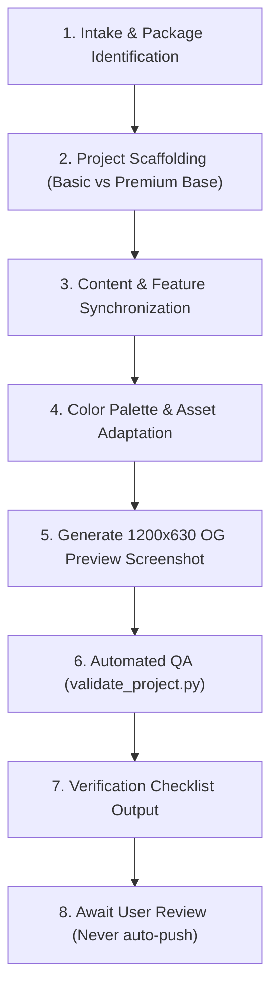

# Quinceañera Invitation Workflow (`quince-workflow`)

This skill automates the complete end-to-end creation, adaptation, styling, and verification of digital quinceañera and Sweet 16 invitations in the Diseños Luna repository, tailoring features precisely to the client's chosen package tier (**Basic** vs. **Premium**).

---

## Diseños Luna Package Comparison

| Feature | Basic Package ($55) | Premium Package ($70) |
| :--- | :---: | :---: |
| **Interactive 3D Opening Envelope** | ✅ Included | ✅ Included |
| **Custom Wax Seal & Monogram** | ✅ Included | ✅ Included |
| **Custom Theme Colors & Foliage Recoloring** | ✅ Included | ✅ Included |
| **Photo Centerpiece** | Single photo (Hero) | Hero + Optional Gallery / Multi-photo |
| **Event Timeline & Schedule** | ✅ Included | ✅ Included |
| **One-Tap Google & Apple Maps** | ✅ Included | ✅ Included |
| **Online RSVP Form (Google Sheets)** | ✅ Included | ✅ Included |
| **Text / WhatsApp Link Preview Card (1200x630 OG)** | ✅ Included | ✅ Included |
| **Calendar Event File (`event.ics`)** | ✅ Included | ✅ Included |
| **Language Support** | Single Language (EN or ES) | **Bilingual Toggle (EN + ES)** |
| **Background Music Player & Auto-play** | ❌ Not included | **✅ Song of choice (`music/song.m4a`)** |
| **Live Event Countdown Timer** | ❌ Not included | **✅ Live Countdown (Days/Hrs/Mins/Secs)** |
| **Falling Celebration Petals / Particles** | ❌ Not included | **✅ Animated Petals / Particles Canvas** |
| **Court of Honor / Chambelanes & Damas** | ❌ Not included | **✅ Court Roster Cards & Monograms** |

---

## Workflow Overview



---

## Phase 1: Intake & Package Identification

1. **Identify Package Tier**:
   - Check the client order form for the package:
     - **Basic ($55)**: Single language (English Only or Spanish Only), no music, no countdown, no falling petals, no court of honor.
     - **Premium ($70)**: Full interactive experience with music, live countdown, falling celebration petals, court of honor, and bilingual switcher (unless client specified a single language).

2. **Verify Inputs**:
   - **Template Selection**:
     - For **Basic ($55)**: Base on `ShantalMesinasBendezu/` (clean basic baseline) or prune from `dianalucero/`.
     - For **Premium ($70)**: Base on `dianalucero/` (full-featured baseline).
   - **Client Intake Details**:
     - Order Reference, Client Name, Contact Phone/WhatsApp, Email.
     - Celebrant Name, Event Type (Quinceañera / Sweet 16), Event Date & Times.
     - Theme & Color Palette (Hex codes or color names).
     - Ceremony & Reception Venues (Names, Addresses, Start Times, Map URLs).
     - Dress Code & Gift Registry (Wishing well / Sobre de regalo).
     - **If Premium**:
       - Audio file or song choice (`music/song.m4a`).
       - Court of Honor roster (Chambelán de honor, Chambelanes, Damas, Padrinos).
       - Countdown target timestamp (`YYYY-MM-DDTHH:MM:SS`).
       - Both English & Spanish translation text.
     - **If Basic**:
       - Chosen primary language (`English Only` or `Spanish Only`).
       - Audio, countdown, petals, and court features are excluded.
   - **Media Assets**:
     - Celebrant portrait photo (`photos/celebrant.png` / `photos/celebrant.jpg`).
     - Venue photos (`photos/venue-church.jpg`, `photos/venue-reception.jpg`).
     - Audio file if Premium (`music/song.m4a`).

---

## Phase 2: Project Scaffolding

1. **Target Directory Naming Convention**:
   - Create a folder in disenosluna/quincelandingpage/<firstnamelastname> (e.g., ictoriarosales/, lexadeharo/, dianalucero/).
   - The target folder must strictly follow the celebrant's **first and last name** in all lowercase alphanumeric characters with no spaces, accents, or special characters.
2. **Copy Base Template**:
   - Copy template files from the chosen base template folder (e.g. lexadeharo/ or dianalucero/) into <target>/.
   - Exclude any .bak, .tmp, or .DS_Store files.
   - Do NOT modify any files in the source template directory.
3. **Full Form Retention in README & Guarantee**:
   - Save the full raw client order form verbatim into <target>/README.md.
   - Must explicitly include Selected Package: Basic () or Selected Package: Premium ().
   - **Form Implementation Guarantee**: Make sure absolutely everything provided in the intake form is accurately implemented into the site.

---

## Phase 3: Content & Feature Synchronization

### A. If Building a **Basic Package ($55)**:

1. **`index.html` (Pruned & Streamlined)**:
   - Set single language attribute: `<html lang="en">` or `<html lang="es">`.
   - Update `<title>`, `<meta name="description">`, and metadata.
   - **Omit floating language switcher bar** (`.floating-lang-bar`).
   - **Omit floating music player bar** (`#audio-control-bar`) and `<audio id="bg-audio">`.
   - **Omit countdown section** (`#countdown` / `.countdown-section`).
   - **Omit petals / confetti canvas** (`#petals-canvas`).
   - **Omit Court of Honor section** (`#court` / `.court-section`).
   - Retain:
     - 3D interactive opening envelope with custom monogram wax seal.
     - Main celebrant photo centerpiece.
     - Event schedule & timeline with venue addresses and map links.
     - Event guidelines (dress code, gift registry / wishing well, host contacts).
     - Online RSVP form connecting to the Diseños Luna Google Sheets endpoint.
   - Bump cache-busting version strings (`?v=...`).

2. **`main.js` (Basic Controller)**:
   - Configure Google Sheets RSVP endpoint, slug, client name, and email.
   - Implement envelope opening animation and scroll unlocking.
   - Handle RSVP form submission, client-side validation, and feedback modal.
   - **Do NOT** include audio control listeners, countdown tick intervals, petal animation physics, or language switching toggle dictionaries.

3. **`event.ics`**:
   - Standard calendar invite with UID, start/end dates, location, and celebrant summary.

---

### B. If Building a **Premium Package ($70)**:

1. **`index.html` (Full-Featured)**:
   - Include floating utility bar with **Language Switcher** (`.floating-lang-bar`) and **Audio Player** (`#audio-control-bar`).
   - Include `<audio id="bg-audio" preload="auto"><source src="music/song.m4a?v=1" type="audio/mp4"></audio>`.
   - Include **Live Countdown Timer** (`<section class="countdown-section" id="countdown" data-target-date="YYYY-MM-DDTHH:MM:SS">`).
   - Include **Falling Celebration Petals / Particles** canvas (`<canvas id="petals-canvas">`).
   - Include **Court of Honor** section (`<section class="court-section" id="court">`) with monogram roster cards.
   - Include multi-photo gallery or secondary venue showcase cards if provided.
   - Retain 3D envelope, RSVP form, timeline, guidelines, and map links.
   - Bump cache-busting version strings (`?v=...`).

2. **`main.js` (Full Interactive Controller)**:
   - Synchronize all translations under `translations = { en: {...}, es: {...} }` for real-time bilingual switching.
   - Attach audio autoplay to envelope wax seal click (`audio.play()`), volume fade-in, and floating play/pause toggle.
   - Initialize live countdown timer updating days, hours, minutes, and seconds every 1000ms.
   - Initialize petal/particle physics canvas with smooth falling animation.
   - Configure Google Sheets RSVP form submission and confirmation modal.

3. **`event.ics`**:
   - Standard calendar invite with UID, start/end dates, location, and celebrant summary.

---

## Phase 4: Color Palette & Asset Adaptation

1. **Calculate Color System**:
   - From the client's color swatch or name (e.g., Sage Green, Emerald, Burgundy, Rose Gold, Royal Blue, Lilac):
     - Calculate target Hue (0–360°), Saturation, and Lightness tiers.
     - Ensure `--theme-primary` has WCAG AA contrast on light backgrounds (≥ 4.5:1).
     - Ensure `--theme-dark` and `--text-dark` have high contrast (≥ 7:1) for body typography and titles.
     - Set `--theme-soft` to the exact accent swatch tone.
     - Set `--theme-green-soft` or equivalent to the gentle pastel background wash.
2. **Update `style.css`**:
   - Variables in `:root`:
     - `--theme-primary`, `--theme-dark`, `--theme-light`, `--theme-soft`, `--theme-green-soft`.
     - `--text-dark`, `--text-charcoal`, `--text-subtle`, `--text-muted`.
     - `--ribbon-blush` and `--ribbon-blush-hover` gradients.
     - `--bg-page-gradient`.
   - Monogram letter gradients (`.rsvp-char`, `.court-char`, `.c-initial`).
   - SVG wax seal gradients matching the theme.
3. **Regenerate & Recolor Flowers & Wax Seal**:
   - Regenerate or recolor the flowers and floral assets using the given theme field and colors (e.g. generate or recolor botanical watercolor corners, divider floral arrangements, and wax seal to harmonize with the theme, strictly avoiding any forbidden colors specified such as Forest Green).
   - Use [scripts/recolor_florals.py](./scripts/recolor_florals.py) or generate new floral assets matching the theme.

---

## Phase 5: Open Graph Preview Screenshot

1. Run [scripts/capture_og_preview.py](./scripts/capture_og_preview.py):
   - Starts a temporary local HTTP server.
   - Launches headless Google Chrome with `--force-device-scale-factor=2 --window-size=1200,630`.
   - Captures the initial landing envelope with personalized wax seal.
   - Downsamples with Lanczos to crisp 1200 × 630px.
   - Saves to `<target>/photos/og-preview.jpg` (quality 94) and `<target>/photos/og-preview.png`.
   - Updates `<meta property="og:image">` and `<meta name="twitter:image">` tags in `index.html`.

---

## Phase 6: Automated Quality Assurance

Run the package-aware validator:
```bash
python3 .agents/skills/quince-workflow/scripts/validate_project.py <target_folder>
```

The script automatically verifies:
1. **HTML Validation**: Verifies all HTML tags open and close properly.
2. **JavaScript Syntax**: Runs `node -c main.js` to ensure zero syntax errors.
3. **Placeholder Scour**: Scans HTML, JS, CSS, and ICS for any leftover names from previous templates.
4. **Package Tier Conformity**:
   - **For Basic**: Confirms no audio elements, audio bars, countdown timers, court sections, or bilingual toggles were mistakenly left in.
   - **For Premium**: Confirms audio players, countdown timers, and interactive elements are present and configured.

---

## Phase 7: Verification Checklist Output

Render a comprehensive markdown audit table comparing every field in `README.md` to the implementation:

| Audit Item | Basic Package ($55) | Premium Package ($70) | Status |
| :--- | :--- | :--- | :---: |
| **Package Tier** | Basic ($55) | Premium ($70) | Verified |
| **Client & Celebrant** | Client & Celebrant Name | Client & Celebrant Name | Verified |
| **Language Mode** | Single Language (EN or ES) | Bilingual Switcher (EN + ES) | Verified |
| **Opening Envelope** | 3D Interactive Envelope | 3D Interactive Envelope | Verified |
| **Wax Seal & Monogram** | Custom Celebrant Initial | Custom Celebrant Initial | Verified |
| **Palette & Styling** | Custom Swatch Colors | Custom Swatch Colors | Verified |
| **Schedule & Venues** | Church & Reception + Maps | Church & Reception + Maps | Verified |
| **RSVP Form & Google Sheet** | Active & Linked | Active & Linked | Verified |
| **Background Music** | *Excluded (Basic)* | Song & Audio Bar Active | Verified |
| **Live Countdown** | *Excluded (Basic)* | Target Date Active | Verified |
| **Falling Petals** | *Excluded (Basic)* | Canvas Particle Loop Active | Verified |
| **Court of Honor** | *Excluded (Basic)* | Roster & Monograms Active | Verified |
| **OG Social Preview** | 1200 × 630 Generated | 1200 × 630 Generated | Verified |

---

> [!IMPORTANT]
> **Safety Rule**: Never run `git push` automatically. Always present the completed project and verification table to the user for review first.
